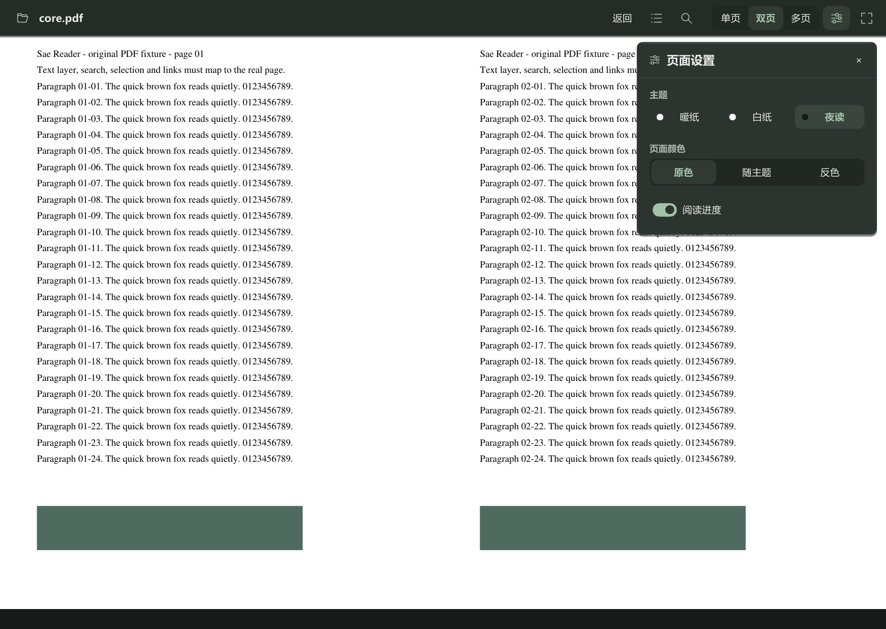

<p align="center">
  
</p>

<h1 align="center">Sae Reader</h1>

<p align="center">Windows 原生电子书阅读器。</p>

<p align="center">
  <a href="https://github.com/PoesisQ/Sae-CN/releases/download/v0.5.0-preview.1/SaeReader-0.5.0-preview.1-windows-x64.zip">下载 Windows x64 版</a> ·
  <a href="https://github.com/PoesisQ/Sae-CN/releases/tag/v0.5.0-preview.1">更新说明与源码</a> ·
  <a href="LICENSE">AGPL-3.0-or-later</a>
</p>

Sae Reader 支持暖纸、白纸与深色主题，可调排版、单页或双页阅读，以及按需展开的目录与设置。
采用原生界面，无账户、广告、云同步或常驻后台服务。

当前为 **v0.5.0-preview.1 预览版**，支持 **EPUB / PDF / TXT / Markdown / AZW3 / MOBI / FB2**，不含 DRM。



## 下载与使用

1. 下载 [Windows x64 压缩包](https://github.com/PoesisQ/Sae-CN/releases/download/v0.5.0-preview.1/SaeReader-0.5.0-preview.1-windows-x64.zip)。
2. 完整解压，双击 `SaeReader.exe`，通过「打开」选择书籍。
3. 鼠标移至窗口上沿展开工具条，选择「单页 / 双页」；点击阅读区域左边上一页、右边下一页。

适用于 Windows 10 / 11 x64，无需安装开发工具。若系统提示缺少 `VCRUNTIME140.dll`
或 `VCRUNTIME140_1.dll`，请安装 [Microsoft 官方 Visual C++ v14 x64 运行库](https://aka.ms/vc14/vc_redist.x64.exe)。

[Release 页面](https://github.com/PoesisQ/Sae-CN/releases/tag/v0.5.0-preview.1) 同时提供独立 EXE、
完整依赖源码、许可证和 SHA256 校验文件；推荐使用包含使用说明与许可文件的 Windows 压缩包。

作为默认阅读器使用时，请将完整程序放在固定目录，以后关闭程序并在同一目录更新。
Windows 会记住程序路径；每次换到不同的版本目录可能仍会启动旧版。
遇到这个问题可参考 [安装、更新与文件关联修复](docs/windows-installation.md)。

## 阅读功能

- **单页 / 双页**：点击左边上一页、右边下一页；链接优先响应，拖动仍可选字。滚轮切换整页或整组双页，窄窗口自动暂用单页。
- **真实重排**：可重排文档的字体、字号、行距、段距、缩进、对齐、正文宽度及四边距可调。
- **舒适主题**：暖纸、白纸和深色；PDF 可选原色、随主题着色或反色，使用 MuPDF 原生处理。
- **阅读工具**：章节目录、内部链接与返回、文字选择与复制、跨章节全文查找及前后定位。
- **PDF 多页**：工具条选择「多页」，横向讲义等可自动排成 2×2；按页面实际比例和窗口尺寸显示两页或四页，窄窗口暂用单页。保留独立单页、双页模式，方向键与滚轮按整组翻页。
- **收起侧栏**：点击文档或页边空白即可关闭目录、排版或查找面板；这一次点击只收起面板。
- **PDF 缩放**：悬停底部旋钮展开大旋钮，向右或向上拖动放大，也支持滚轮。点「100%」回到整页，点「适宽」填满当前页栏。PDF 移除固定外边距和页间缝，放大后仍可用左右键按当前模式翻页。
- **跳页**：拖进度条能先看到目标页码，松手才跳转。点击页码或按 `Ctrl+G`，输入页数后回车。双页和四页模式显示包含目标页的整组。
- **Kindle 与 FB2**：无 DRM 的 AZW3/KF8、MOBI 以及 FictionBook；保留文字、目录、图片、样式与链接，按需解析，共用原生渲染与搜索。
- **文本与 Markdown**：自动识别编码，可手动切换；保留 TXT 空行与缩进，Markdown 支持标题、列表、引用、代码、表格、本地图片与链接。
- **Markdown 公式**：支持 `$...$`、`$$...$$` 和 `math` 块中的常见 LaTeX；分式、根式、上下标、矩阵和对齐公式由原生引擎绘制，保留文字坐标。普通代码保持原义，复杂命令保留源码。[语法与范围](docs/markdown-math.md) · [实测记录](docs/iteration-0.4.1.md)。
- **记住位置**：正常关闭或切书时保存排版、阅读模式及每本书的阅读位置及手动文本编码。
- **沉浸阅读**：点击系统最大化按钮、双击标题栏或按 `F11`，都会进入隐藏标题栏和任务栏的全屏。鼠标靠近边缘时显示工具栏；目录与设置覆盖在正文之上。

## 快捷键

| 操作 | 快捷键 |
|---|---|
| 打开文件 | `Ctrl+O` |
| 上一页 / 下一页 | 左右方向键、`PageUp` / `PageDown` |
| 输入页码跳转 | 点击页码或 `Ctrl+G` |
| 全文查找 | `Ctrl+F` |
| 复制所选文字 | `Ctrl+C` |
| 调整可重排文字字号 / PDF 缩放 | `Ctrl+Plus` / `Ctrl+Minus` |
| PDF 平移 | 放大后的上下键与滚轮、Shift+滚轮横移、中键或右键拖动 |
| PDF 缩放 | 底部旋钮、Ctrl+滚轮 |
| 恢复 PDF 适页 / 默认字号 | `Ctrl+0` |
| 固定 / 自动收起工具栏 | `F10` |
| 全屏 / 退出全屏 | `F11` / `Esc` |

## 数据与便携模式

默认设置与阅读位置保存在 `%LOCALAPPDATA%\SaeReader\state.json`。
需要便携使用时，在程序目录启动：

```powershell
.\SaeReader.exe --portable
```

此时数据写入程序旁的 `data/` 文件夹。卸载时关闭程序并删除程序文件夹；
个人阅读记录可按需另行删除。

## 当前限制

- 尚未提供拖入打开、OCR 或整本书的常驻搜索索引。全文查找按需逐页扫描，扫描 PDF 需要已有文本层。每页查找上限 4096 个区域，同时最多高亮 256 个及当前区域。
- 常见 Ruby 与部分 MathML 使用按需生成的 SVG 兼容，保留上下结构与分数、上下标；矢量文字保留选择与搜索。复杂数学结构、竖排、不同画布尺寸的固定布局等仍有限制，不能宣称 EPUB 3 全兼容。
- 部分编辑控件下的全局快捷键、完整无障碍与干净 Windows 虚拟机验收仍待补齐。
- 不支持 DRM、嵌入脚本或多媒体播放。

详情见 [已知限制](docs/known-limitations.md)、[EPUB 兼容性](docs/epub-compatibility-matrix.md)
和 [本版实测](docs/iteration-0.5.0.md#性能实测)。

## 开发与许可

原生、简洁、高效是首要原则。主体使用 Rust，配合 Slint 原生界面和 MuPDF；格式适配、字体与全文查找按需工作，无 WebView 或浏览器运行时。[开发与构建说明](docs/development.md) 包含工具、测试和打包步骤。

应用代码采用 [AGPL-3.0-or-later](LICENSE)，依赖保留各自许可。
每个二进制 Release 同时提供对应源码及许可文件。

图标：[PNG 原稿](https://github.com/PoesisQ/Sae-CN/releases/download/v0.5.0-preview.1/SaeReader-icon.png) · [Windows ICO](https://github.com/PoesisQ/Sae-CN/releases/download/v0.5.0-preview.1/SaeReader.ico)。
