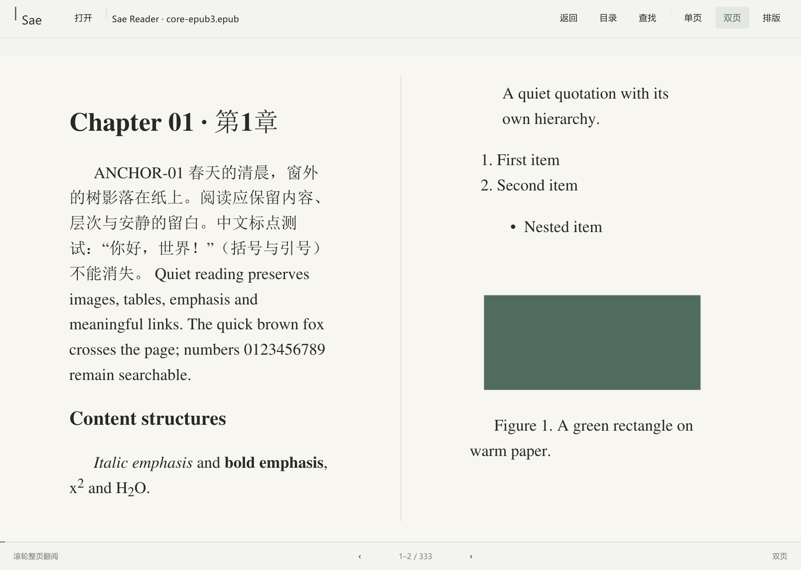

<p align="center">
  
</p>

<h1 align="center">Sae Reader</h1>

<p align="center">安静、轻量的 Windows EPUB / PDF 阅读器。</p>

<p align="center">
  <a href="https://github.com/PoesisQ/Sae-CN/releases/download/v0.1.0-preview.1/SaeReader-0.1.0-preview.1-windows-x64.zip">下载 Windows x64 版</a> ·
  <a href="https://github.com/PoesisQ/Sae-CN/releases/tag/v0.1.0-preview.1">更新说明与源码</a> ·
  <a href="LICENSE">AGPL-3.0-or-later</a>
</p>

Sae Reader 将注意力留给书页：暖纸、白纸与深色主题，可调排版，单页或双页阅读，
以及需要时才展开的目录与设置。采用原生界面，无账户、广告、云同步或常驻后台服务。

当前为 **v0.1.0-preview.1 预览版**，实际支持 **EPUB / PDF**。



## 下载与使用

1. 下载 [Windows x64 压缩包](https://github.com/PoesisQ/Sae-CN/releases/download/v0.1.0-preview.1/SaeReader-0.1.0-preview.1-windows-x64.zip)。
2. 完整解压，双击 `SaeReader.exe`，点击「打开」选择 EPUB 或 PDF。
3. 顶部切换「单页 / 双页」，使用滚轮或方向键整页翻阅。

适用于 Windows 10 / 11 x64，无需安装开发工具。若系统提示缺少 `VCRUNTIME140.dll`
或 `VCRUNTIME140_1.dll`，请安装 [Microsoft 官方 Visual C++ v14 x64 运行库](https://aka.ms/vc14/vc_redist.x64.exe)。

[Release 页面](https://github.com/PoesisQ/Sae-CN/releases/tag/v0.1.0-preview.1) 同时提供独立 EXE、
完整依赖源码、许可证和 SHA256 校验文件；推荐使用包含使用说明与许可文件的 Windows 压缩包。

## 阅读功能

- **单页 / 双页**：滚轮一次切换整页或整组双页；窄窗口自动暂用单页。
- **真实重排**：EPUB 字体、字号、行距、段距、缩进、对齐、正文宽度及四边距可调。
- **舒适主题**：暖纸、白纸和深色；PDF 保留固定版式，提供独立缩放。
- **阅读工具**：章节目录、内部链接与返回、文字选择与复制、当前页查找。
- **记住位置**：正常关闭或切书时保存排版、阅读模式及每本书的阅读位置。

## 快捷键

| 操作 | 快捷键 |
|---|---|
| 打开文件 | `Ctrl+O` |
| 上一页 / 下一页 | 方向键、`PageUp` / `PageDown`、滚轮 |
| 当前页查找 | `Ctrl+F` |
| 复制所选文字 | `Ctrl+C` |
| 调整 EPUB 字号 / PDF 缩放 | `Ctrl+Plus` / `Ctrl+Minus` |
| 显隐工具栏 | `F10` |
| 全屏 | `F11` |

## 数据与便携模式

默认设置与阅读位置保存在 `%LOCALAPPDATA%\SaeReader\state.json`。
需要便携使用时，在程序目录启动：

```powershell
.\SaeReader.exe --portable
```

此时数据写入程序旁的 `data/` 文件夹。卸载时关闭程序并删除程序文件夹；
个人阅读记录可按需另行删除。

## 当前限制

- TXT / Markdown、拖入打开和跨章节全文搜索尚未提供；当前查找只覆盖当前页。
- 部分复杂 EPUB 3 内容仍有兼容性问题，包括 Ruby 注音、MathML、竖排及固定版式。
- PDF 放大后的平移、部分控件下的 Escape 行为仍需完善。
- 不支持 DRM、嵌入脚本或多媒体播放。

详情见 [已知限制](docs/known-limitations.md)、[EPUB 兼容性](docs/epub-compatibility-matrix.md)
和 [性能实测](docs/performance-report.md)。

## 开发与许可

使用 Rust、Slint 和 MuPDF 构建。[开发与构建说明](docs/development.md) 包含工具、测试和打包步骤。

应用代码采用 [AGPL-3.0-or-later](LICENSE)，依赖保留各自许可。
每个二进制 Release 同时提供对应源码及许可文件。

图标：[PNG 原稿](https://github.com/PoesisQ/Sae-CN/releases/download/v0.1.0-preview.1/SaeReader-icon.png) · [Windows ICO](https://github.com/PoesisQ/Sae-CN/releases/download/v0.1.0-preview.1/SaeReader.ico)。
