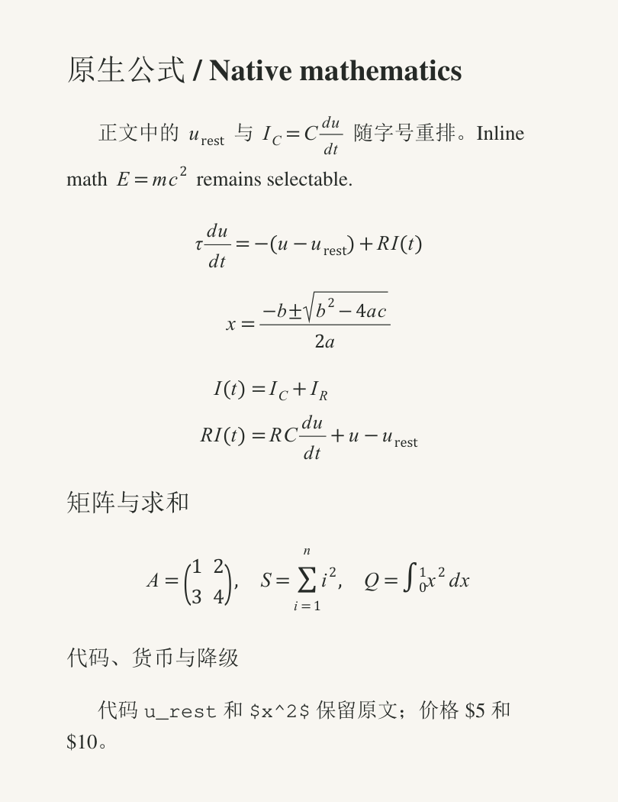
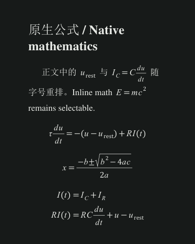

# 0.4.1 Markdown 公式与原生缓存实测

2026-11-03，Windows x64，Rust + Slint 软件渲染 + 原生 MuPDF。
本轮用户正在高强度使用电脑，明确要求不打开/关闭测试窗口或占用屏幕。
因此只构建程序、运行无窗口原生测试、查看离屏页面；没有启动 GUI 主函数或操作桌面。
本轮没有重测窗口首次可见、空闲 CPU、桌面 DPI、全屏交互或干净虚拟机，不宣称这些闸门通过。

## 原因与实现

用户示例中的公式原本使用普通文本、反引号和无语言代码块，保留这些内容的代码语义。
用户选择只更新阅读器，原讲义没有改写或复制到仓库。

标准 `$...$`、`$$...$$` 和 `math` 围栏块现在按需调用一个纯 Rust 解析器，再由 Rust 布局成 SVG 文字与几何图形，交给已有 MuPDF 绘制。
没有浏览器、JavaScript、额外转换进程、常驻索引或计时器。普通文档不初始化数学排版器。
字体读取 Windows Cambria Math / Times New Roman，不在 Windows 运行包中分发字体。
完整语法和边界见 [公式说明](markdown-math.md)；这是常见数学排版子集，不是完整 TeX。

离屏检查定位并修补了三处原生问题：

- HTML 忽略图片的 `vertical-align:middle`，使行内公式基线偏高。现在正确计算上下占位及基线。
- SVG 忽略指定的数学字体，替换成 Base14 Times，使测量和实际绘制不一致。现在两个数学字体族使用既有 Windows 映射加载器。
- 图片被缩小到当前页剩余高度，导致页底公式突然变小。数学行内图使用整页高度作为上限，放不下时换页。原有 EPUB Ruby/MathML 兼容生成图保持显式 baseline 布局，保留此前的行内位置。

另外修复了先解析公式、后打开首本文档时，字体缓存与原生上下文在线程退出时的释放顺序。

## 无窗口内核测量

普通发行程序继续使用默认 Release 配置；基准也以默认功能、优化构建运行测试入口，不创建窗口。
开发/测量进程限制为单逻辑核、BelowNormal；每组 1 次预热 + 40 次打开、布局、首屏绘制、关闭。
主机为 Windows 11 26200 x64、i9-14900HX（24 核 / 32 逻辑处理器）、约 16 GiB 物理内存、NVMe；历史环境记录见 [性能报告](performance-report.md)。未更改杀毒策略，未独立核对杀毒扫描状态。
窗口大小对应 540 × 700 pt，光栅化比例 1.5，RGB 图像 810 × 1050。
编译与测量顺序执行，用户的其他工作持续进行，时间数值只描述此主机热态内核。

| 自有样本 | 打开至首屏绘制 median / p95 / max | 绘制后私有内存中位数 | 第 10–40 次关闭后私有内存变化 |
|---|---:|---:|---:|
| 普通 Markdown（含图片、代码、表格） | 14.15 / 46.40 / 65.14 ms | 6.04 MiB | +84 KiB |
| 7 组行内/独立公式 | 35.45 / 45.42 / 86.22 ms | 7.06 MiB | −136 KiB |

p95 采用 nearest-rank。没有删除高负载主机上的慢样本。

**这些是原生内核测试进程的数据，不包含 Slint 窗口，不能当成整款阅读器内存或启动时间。**
首轮清理前的 20 次记录显示普通 Markdown 关闭后累积约 4.70 MiB；只清资源 store 的中间版本仍不能满足重复关闭检查。
最终在关闭或替换 Book 时释放资源 store 和字形缓存，包括字形缓存持有的旧字体引用。
活跃对象保有自身引用，当前书的阅读和像素缓存预算继续保留；没有用工作集修剪伪造内存下降。
前后基准编译功能和循环次数不同，原始记录保留，仅用来定位保留资源；上表给出最终配置的独立测量。

位图缓存仍为 16 MiB，原生 store 上限仍为 32 MiB，Windows 字体映射缓存仍按既有 32 MiB 文件预算控制。
这些预算不等于整个进程内存上限。数学解析中间数据在转换后释放；每个公式 8 KiB、4096 个事件、32 层，每份 Markdown 1024 个公式、最多 8 MiB 生成标记。

最终普通 EXE：24,357,888 字节，比 0.4 增加 248,320 字节（约 1.03%）。
SHA256：`f2299da912cc8b269cbec44e0b7ed7c2102117e549afc85b167db75a676ff023`。

## 验证范围

- 中间完整无窗口原生回归共 36 项返回通过，其中 3 项本地书籍条件测试没有设置环境，实际未启用；另有 1 项性能测试默认忽略。本轮不声称重跑了用户的真实书库。
- 随后针对最终页底换页、字体、括号、缓存及 EPUB 基线修补，在普通默认功能下编译相应测试入口，复核 Markdown 数学、资源释放、EPUB/PDF/TXT/Markdown 正文/图片/链接、选择/搜索、字号重排及缩放。测试没有创建 Slint 窗口。
- 实际字形检查包含 Cambria 数学文字、有限坐标、行内 E 与相邻正文基线、公式中的 `rest` 搜索和代码原文保留。
- 最终普通默认功能的公式单测通过：分式、根式、上下标、矩阵、对齐组、求和/积分和中文数学文字；未知命令、递归宏、过深嵌套与负间距被拒绝。该测试只验证原生布局输出，不创建窗口。
- 窄版深色文档逐页检查普通 I 字形至少保持请求字号的 92%，防止页底缩小；保留原始截图作为前后证据。
- 宏展开、过深结构、负间距、未知命令等无法完整显示时保留源码，不静默丢掉公式。





原始计数、回归日志及源码/代码显示见 [证据目录](evidence/iteration-0.4.1/)。
此前 EPUB 复杂排版、竖排、完整数学属性、无障碍和窗口验收的剩余边界仍有效；本轮不宣称 Phase 0–5 全项完成。

## 构建与复现

设置 `scripts/env.ps1` 后以 `_CL_=/MP1`、`CARGO_BUILD_JOBS=1` 限制构建并发。开发进程使用 BelowNormal、单逻辑核亲和性。

```powershell
cargo build --release --locked --offline -j1 --bin sae-reader
cargo test --release --locked --offline -j1 --lib math::tests::native_tex_supports_common_structures_and_rejects_partial_or_unbounded_math -- --test-threads=1
cargo rustc --release --locked --offline -j1 --test markdown_math --message-format=json
cargo rustc --release --locked --offline -j1 --test reader_features --message-format=json
cargo rustc --release --locked --offline -j1 --test math_performance --message-format=json
```

后三项从各自 Cargo JSON `compiler-artifact` 记录中取对应 `target.kind=["test"]` 的 executable，只执行测试入口并加 `--test-threads=1`。性能测试需显式设置 `SAE_MATH_BENCH_REPORT` 输出路径并添加 `--ignored`；截图测试可设 `SAE_MATH_EVIDENCE_DIR`。不运行 GUI 主程序。
