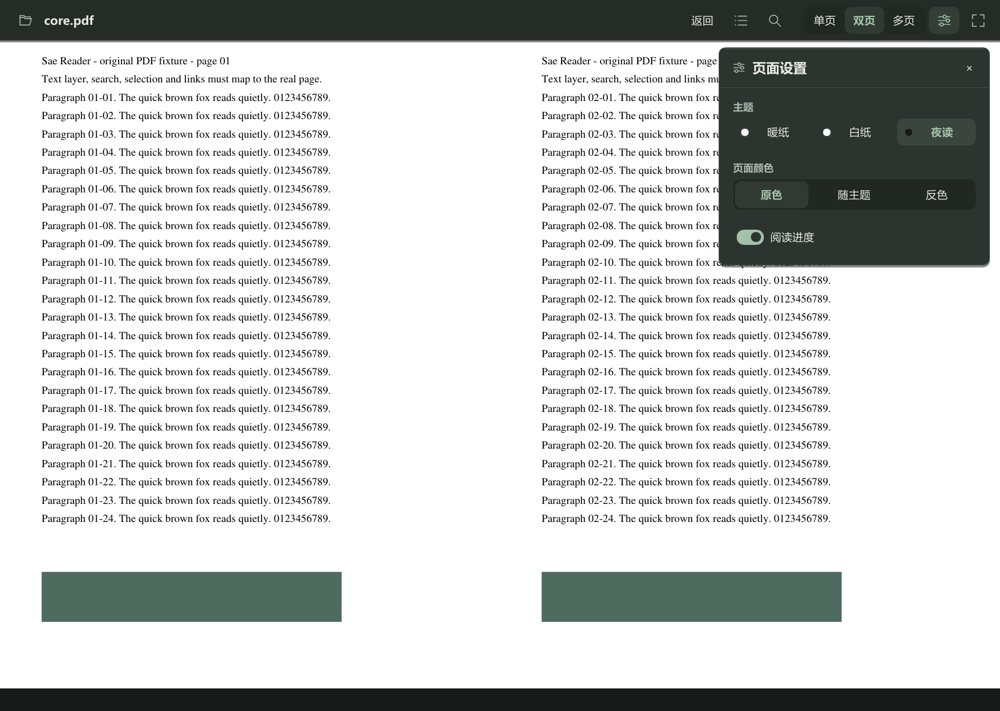

# v0.5.0-preview.1 Windows 阅读交互

系统最大化和双击标题栏进入 Winit 无边框全屏，`Esc` 回到窗口。顶部工具栏贴住客户区上沿，悬停层和侧栏保持同一阅读视区。PDF 单页、双页和 2×2 多页使用实际画布尺寸，去掉固定外边和中缝。适宽铺到当前页栏边缘，100% 恢复整页。

底部旋钮悬停放大。一次拖动越过起步阈值后固定主方向，向右或向上放大，鼠标离开旋钮也能继续。整页和铺满挡位保留短暂阻尼，盘面随数值转动。进度条按拖动位置预览目标页，松手才请求页面。点击页码或按 `Ctrl+G` 可输入目标页。左右键在 PDF 放大时也按阅读模式翻页，上下键可继续平移。

## Refactoring UI 审查

| 旧界面出现的问题 | 对应原则 | 本轮处理 |
|---|---|---|
| 工具条与标题栏之间露出一段正文，浮层边界互不对齐 | 间距系统、相邻元素关系 §3.3、§3.6 | 工具条贴上沿，侧栏从同一基线开始，与底部进度留出间隔，命令按图标与阅读模式分组。 |
| PDF 设置把主题选项和颜色下拉框拉伸到几百像素高，标签离控件太远 | 缩紧次要内容与空间层次 §2.1、§3.6 | 面板按真实内容收紧，主题、页面颜色、进度用固定行高。可重排面板有独立滚动区，保留文字、段落与版心设置。 |
| 左右浮层和控件同一明度，分不出标题、正文选项、选中状态 | 字重与颜色层次 §2.2、§4.1、§4.3，轻量深度 §6.4 | 标题、分组、正文用不同字重和对比，面板增加一条边缘高光和 3px 实色接触阴影，选中项用浅底和细轨。目录按层级缩进，长标题在滚动条前换行。 |
| 旋钮的实际操作范围狭窄，缩放状态和挡位藏得太深，拖页时数字无反馈 | 强调结果与按需呈现 §2.1、§8.5 | 悬停时展开大刻度盘和两个常用挡位。百分比、预览页码与编辑态直接跟随操作。 |
| 设置的系统强调色跳出阅读主题 | 中性色与状态区分 §5.6、§8.6 | 排版滑轨、进度和对齐开关跟随阅读主题，使用位置和明度表示状态，保留精确输入、焦点和可访问名称。 |

界面使用 Slint 原生矩形、文字和现有细线图标。浮层按需构建，旋钮转动只由输入触发，渲染节流仍为 80ms 单次计时。无新增运行依赖，缓存预算沿用现有值。

- [窄窗夜读目录](evidence/iteration-0.5.0/contents-night.png)保留完整标题和独立的滚动条空间，面板底部与进度栏之间有可见间隔。
- [窄窗排版设置](evidence/iteration-0.5.0/typography-narrow.png)展示实际可调字号、行距与数字输入。
- [展开的缩放旋钮](evidence/iteration-0.5.0/zoom.png)、[拖动时的目标页码](evidence/iteration-0.5.0/page-preview.png)与[四页 PDF](evidence/iteration-0.5.0/pdf-grid.png)均来自原创样本。

## Windows 验证

Windows 11 26200 x64、Core i9-14900HX、32 个逻辑处理器、约 64 GiB 内存、NVMe。实际系统 DPI 为 150%。另在原生窗口中用 `SLINT_SCALE_FACTOR` 检查 100%、125%、200% 下的窄窗排版。绘制截图使用 Slint 软件渲染器，自动化走程序的原生窗口和事件路径。桌面锁定期间用 Winit 原生最大化与客户区坐标验证全屏，再通过 Slint 事件检查旋钮、键盘、跳页和侧栏。

`cargo test --release --locked --offline --lib --test g1_native --test reader_features --test pdf_grid --test ebook_formats --test markdown_math -- --test-threads=1` 返回 33 项通过。外部 KF8 fixture 的一项为选做，当前未提供该文件。其余测试覆盖 EPUB 目录、非文本内容和重排锚点，PDF 的文字层、链接和取景，TXT 编码、Markdown 数学公式，以及常规 AZW3、MOBI、FB2。

12 组窗口场景覆盖全屏下 2560×1600 物理客户区、退出后恢复 1180×840 逻辑窗口、拖动期间保持原页且预览第 26 页、松手跳转、页码有效范围、放大后的方向键、样式修改和切书。压力场景在两个样本间完成 500 次翻页、100 次字号调整、100 次窗口改尺寸、30 次切换，共 730 次，缓存最高约 15.65 MiB。跨显示器、解锁后的物理鼠标与键盘、完整无障碍仍待检查。

## 性能实测

首屏由 `scripts/qa-windows.py --scenario startup --runs 20` 测量。从进程进入主函数，到 Slint 窗口完成实际像素快照。稳态由 `scripts/profile-window.py --runs 3 --seconds 6` 从普通发布进程外部读取 Windows 计数器，取每轮第 3 秒之后的稳态中位数，再取三轮中位数。使用独立阅读配置，文档只读。SumatraPDF 3.6.1 使用已验证签名的便携程序，单页适页，两款程序分别使用自己的默认窗口尺寸。

| 场景 | 暖启动首屏中位数 / P95 / 最大值，ms | 稳态私有内存 v0.4.1 → v0.5.0，MiB | SumatraPDF 私有内存，MiB |
|---|---:|---:|---:|
| 空白 | 47.17 / 50.21 / 50.31 | 13.91 → 13.65 | 14.40 |
| 原创 EPUB 单页 | 157.95 / 164.06 / 267.19 | 27.07 → 26.73 | — |
| 原创 PDF 单页 | 156.69 / 161.23 / 194.31 | 21.84 → 21.86 | 14.54 |
| 1156 页实书 PDF，单页 | 160.08 / 179.73 / 385.07 | 26.34 → 25.00 | — |
| 同一份 PDF，双页 | 209.23 / 216.26 / 351.74 | 28.92 → 30.93 | — |

100 次暖启动及 36 次稳态采样全部完成。两版 Sae 各 15 轮的空闲 CPU 增量均为 0ms，每轮计数区间约 2.8 秒。双页扩大了可见页栏，实测增加 2.01 MiB 私有内存。压力场景第 50、500、700 次操作的私有内存为 35.09、36.39、30.82 MiB。发行 EXE 为 24,926,720 字节，比 0.4.1 增加约 0.54 MiB。

原始计数、构建 SHA256、窗口事件与图像信息见 [性能样本](evidence/iteration-0.5.0/performance.json)、[窗口回归](evidence/iteration-0.5.0/windows.json)与[截图清单](evidence/iteration-0.5.0/images.json)。首屏计时从程序入口开始。实际桌面合成首帧、冷启动和干净 Windows 虚拟机仍待验收。
