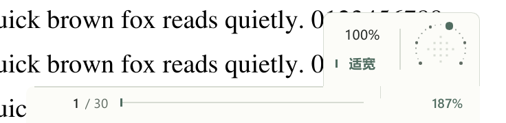
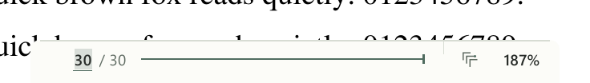

# v0.5.1-preview.1 底栏与缩放

底栏沿用纸面和夜读两套配色，贴住窗口下沿。先看到当前页和当前倍率，分母、刻度与次要动作退到一层。页码进入编辑状态时位置不跳动，拖动进度条时短刻度和页码一起移动。

PDF 缩放入口取自参考图里互相错开的轮廓，用三道页角表示尺寸变化。展开后用点的大小区分刻度，较大的点对应 25%、50%、100%、200%、400% 和 800%。指示点随滚轮或拖动移动，常用挡位在左，百分比与旋钮上下对齐。几何组织借鉴了由少量规则构成网格的做法，交互参考单个旋钮对应一个参数的布局。 [css-doodle](https://github.com/css-doodle/css-doodle) · [OP–1 控制指南](https://teenage.engineering/guides/op-1/original/quick-guide)

夜读与窄窗使用同一套位置和手势。 [夜读缩放盘](evidence/iteration-0.5.1/zoom-night.png) · [夜读页码编辑](evidence/iteration-0.5.1/page-entry-night.png)

## Refactoring UI 审查

| 旧界面 | 原则 | 调整 |
|---|---|---|
| 百分比重复出现，读数、挡位和拖动区域像三组控件 | §2.4、§3.6 | 只保留一个读数，使展开的控制区和底栏相接。 |
| 页码编辑外框与底栏外框争抢注意力 | §4.4、§8.5 | 编辑保持同一基线，焦点落在数字本身，分母和进度轨道位置稳定。 |
| 圆形外轮廓压过实际指针，预设高亮占满一行 | §2.7、§5.7、§6.4 | 小入口以页角取代圆轮廓。展开时用点径、位置与明度区分刻度和当前值。预设的选中状态由短竖线与字重共同表明。 |

使用 Slint 原生图形。点阵随展开区创建，调节结束后短动画自行停止。截图均为项目原创 PDF 和 EPUB 样本在 Windows 软件渲染窗口中的实际像素。

## Windows 实测

Windows 11 x64 上完成八组原生窗口场景和 730 次连续操作，覆盖 150% 系统 DPI、125% 和 200% 受控缩放、点阵位置变化、缩放预设、跳页、原位编辑、PDF 多页与 EPUB 重排。Rust 测试套件报告 33 项通过，其中依赖外部 KF8 文件的选做项未提供输入。

| 输入 | 首屏中位数 v0.5.0 → v0.5.1，ms | 稳态私有内存 v0.5.0 → v0.5.1，MiB |
|---|---:|---:|
| 空白 | 109.68 → 94.03 | 13.75 → 13.77 |
| 原创 PDF | 166.70 → 155.42 | 21.95 → 21.87 |
| 原创 EPUB | 167.27 → 164.38 | 26.93 → 26.90 |

每版每项 20 次暖启动，计时从程序入口到窗口像素快照。另用普通发行 EXE 运行三轮，每轮六秒，从第三秒开始读进程计数器。18 轮稳态区间的 CPU 时间增量均为 0 ms，观察时长约 2.8 秒。发行 EXE 为 24,987,648 字节，比上一版多 60,928 字节。冷启动、系统合成首帧与多屏切换留待专门验收。 [样本数据、视区和构建校验值](evidence/iteration-0.5.1/windows.json)
