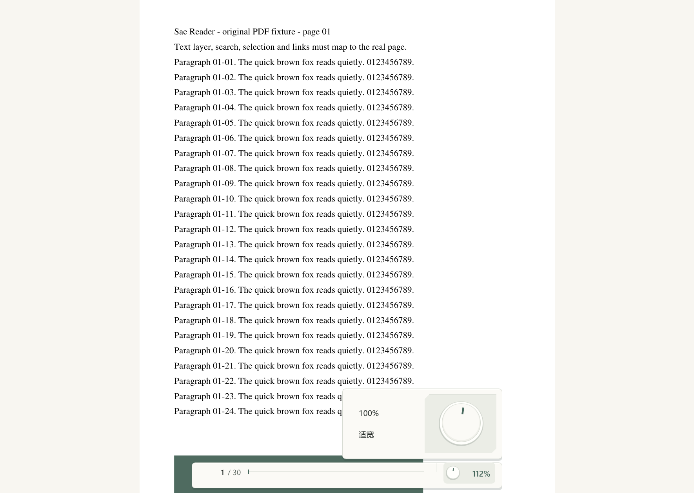
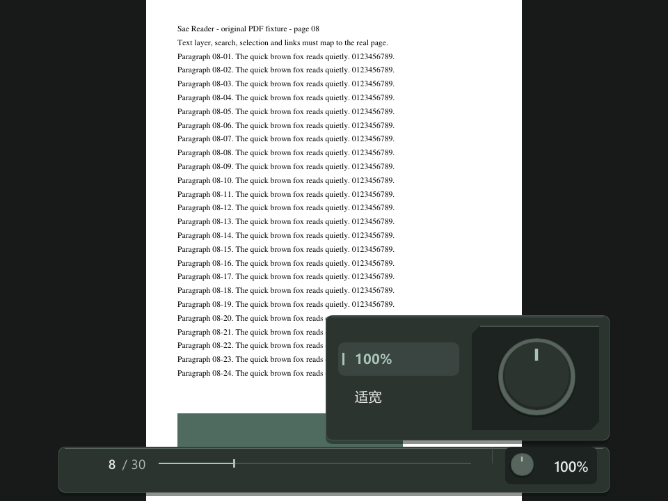

# v0.5.2-preview.1 阅读界面与缩放

工具条、侧栏和底部控制区使用同一组暖白、墨灰与青灰。夜读靠石墨色的明度差区分纸面、面板和凹位。工具浮层沿窗口边缘布置，让正文在平时拥有完整画布。

## Refactoring UI 审查

| 位置 | 原则 | 改动 | 实测 |
|---|---|---|---|
| 正文左下方 | §2.1、§2.4 | 取消悬浮格式诊断。图片、链接和公式出现显示问题时，可从「阅读设置 → 文档信息」查看。查找结果数随查找框显示。 | Markdown 打开目录时正文仍可完整显示。 |
| 窗口上沿和左右面板 | §3.2、§3.6 | 顶栏贴边。目录与设置统一宽度、起点和上沿。栏内紧凑排列，组间留足间距。 | 附有窄窗和宽窗截图。 |
| 目录及排版字段 | §4.2、§4.4、§4.7 | 英文顶层目录用 Georgia，其他条目沿用系统界面字体。子项缩进，长标题换行。排版的标签、滑轨与精确值排在一行。 | 检查了长中英文标题、目录滚动与实际字号重排。 |
| 选中、焦点与深度 | §5.6、§5.7、§6.1、§6.4 | 用窄刻线和字重标示挡位。浅色和夜读靠明度区分层级。面板用薄高光与实色接触影。 | 36 组文字色与工具面背景的对比度均达到 4.5:1。 |
| PDF 缩放 | §3.3、§6.2、§8.6 | 272 × 120 逻辑像素的展开面板与底栏右边对齐。右侧 76 像素圆面用刻线显示方向，左侧是适页、适宽和可用时的铺满挡位。 | 两种显示尺寸使用相同的直拖规则，明暗截图都可见刻线与凹位。 |

[长目录夜读截图](evidence/iteration-0.5.2/contents-night.png) · [排版设置截图](evidence/iteration-0.5.2/typesetting.png) · [Markdown 正文截图](evidence/iteration-0.5.2/markdown.png)

## 缩放与提示

左键按下后，首次有效位移确定横向或纵向。接下来的倍率取决于光标离按下点的距离。向右或向上放大，反向缩小。离开控件范围后仍可完成拖动，松手以最后位置为准。经过挡位有短距离停顿，继续移动即可越过。轻点底部拨盘可固定或放开挡位面板。按 Esc 或点正文可收起。

读数和刻线立即更新。光栅刷新最多合并到一个待提交的视图，当前任务完成后绘制最新倍率。短时合并通过单次计时器实现，倍率和页面内容仍由原生 Rust 与 MuPDF 驱动。

旧提示把格式、编码、代码换行和未载入的资源都写到同一条消息。现在编码在原有的文本编码区显示。图片未载入和链接不可用分别计数，公式降级的原文仍可读。

## Windows 实测

| 样本 | 暖启动首屏中位数 v0.5.1 → v0.5.2，ms | 稳态私有内存 v0.5.1 → v0.5.2，MiB |
|---|---:|---:|
| 空白 | 67.12 → 63.25 | 13.68 → 13.58 |
| 原创 PDF | 158.73 → 162.95 | 21.81 → 21.79 |
| 原创 EPUB | 170.92 → 155.08 | 26.93 → 26.72 |

Windows 11 26200.9974，i9-14900HX，实际 DPI 为 150%。每个版本和样本各运行 20 次暖启动，以程序入口到窗口像素快照计时。稳态是普通发行 EXE 的 3 轮 6 秒外部进程采样，取第三秒后的中位数。新版 9 轮标准样本在约 2.8 秒的测量区间内 CPU 时间增量均为 0 ms。发行 EXE 为 25,107,456 字节，增加 119,808 字节。

80 项拨盘事件覆盖滚轮、往返拖动、粗细事件步长、松手位置、挡位与最终原生倍率。111 项键盘场景覆盖放大翻页、查找、目录与全屏。另检查了四页 PDF、730 次连续操作、长目录，以及 100%、125%、150%、200% 缩放下的真实窗口。100%、125% 和 200% 由窗口测试工具设定。完整冷启动、多显示器切换和读屏验收仍待验证。

十份实书 PDF 在单双页 300% 下均生成了视区大小内的像素。1156 页实书的双页暖启动首屏中位数为 218.98 ms，三轮测试。延长两轮采样到 12 秒后，稳态私有内存为 29.97 MiB，区间内 CPU 时间增量分别为 31.25 和 0 ms。公开证据只包含匿名编号、页数和计数器，截图来自原创样本。 [Windows 样本、测量口径和校验值](evidence/iteration-0.5.2/windows.json)
