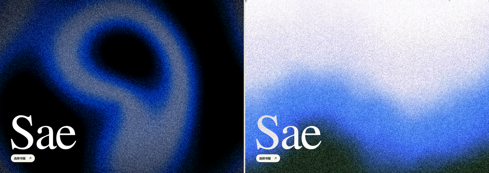

# 0.6.5-preview.2 · 页面抓取与封面字标

## 放大后查看页面四边

当 PDF 的实际尺寸超过当前分栏，按住左键就能抓住页面横移或纵移。按住 Shift 再拖动可以选字，短按仍可翻页或打开书内链接。单页、双页及多页共用这一手势。在目录或书内链接跳转后，顶栏会出现「回到跳转前」。

Windows 测试在一份 30 页的自制 PDF 上使用 400% 缩放，分别检查单页、双页和八页。每个长度和方向都通过原生窗口发送鼠标事件，并核对每一张可见页面在 MuPDF 中的实际裁切坐标。三种布局都到达四角，继续向边界外拖时新增渲染请求为零。三组也检查了 Shift 选字、短按翻页、目录跳转及返回原来的页组。平移时只绘制当前可见的裁切区域，连续输入合并在 40 毫秒的单次刷新内。

## 首页与阅读控件

蓝白首页的黑白字标取自同一帧每个像素的相对亮度。Plasma 在字标内保留色相。两种字标的边缘都由字形覆盖率直接混合，三种封面共用「选择书籍」入口。按下按钮时，墨色延伸到圆角边缘。28 张静态或运动截图对照了实际渲染帧或原始静帧，覆盖 100% 至 250% 显示缩放。

蓝白色带底部原有的横带来自细化颗粒后的纵向重复。纹理底部有较强的颗粒，跨过接缝后却采到了最上面较淡的纹理。现在从颗粒强度相近的区域接续，采样行预先算好。以色带首帧为例，接缝上下两侧的相邻像素亮度差均值原为 26.22 和 8.78，现在为 26.22 和 26.11，量程为 0–255。十个时间点均复核了色场和颗粒，Plasma 的十张背景帧与上一版本逐字节一致。

常规 PDF 窗口中，顶栏的视觉中线位于 26 个逻辑像素。拨轮的收起和展开半径分别为 72 和 88，挡位文字随同一次展开过渡放大。毛玻璃继续共用一张至多 144 × 100 的低频取样图。替换文档像素时更新这张图，悬停和选字可复用已有取样。黑白纸面的亮度变化受到约束，彩色书页仍能透出底色。在同一目录保持展开的情况下，白纸切为黑纸再切回，目录样点的 RGB 从 (245, 247, 242) 变为 (228, 230, 224)，最后恢复为 (245, 247, 242)。静置时取样图与控件表面的重建次数均为零。

## Windows 实测

Windows 11 Home x64，Core i9-14900HX，32 个逻辑处理器，原生软件渲染。每个场景交错启动两个版本各十次，用可取得原生首幅窗口截图的时间统计热启动。内存使用发行 EXE 每个场景三个独立进程的稳定期私有字节中位数，每次观察六秒。

| 场景 | preview.1 中位数 / P95 | preview.2 中位数 / P95 | preview.1 私有内存 | preview.2 私有内存 |
| --- | ---: | ---: | ---: | ---: |
| 首页静置 | 53.19 / 58.03 ms | 53.39 / 58.21 ms | 17.62 MiB | 17.41 MiB |
| PDF | 148.77 / 156.25 ms | 151.11 / 153.70 ms | 24.29 MiB | 24.26 MiB |
| EPUB | 148.67 / 149.97 ms | 149.66 / 153.71 ms | 21.64 MiB | 21.70 MiB |

蓝白封面播放时，发行 EXE 两次测得约 20.2–20.4 MiB 私有内存，消耗一个逻辑处理器的 20.4%–22.2%。最小化后两次 2.5 秒观察的 CPU 时间均为零。打开文档后，首页定时器停下并释放画面缓冲。PDF 静置的三次观察分别记录到 15.6、0 和 15.6 毫秒 CPU。发行 EXE 为 26,172,416 字节，比 preview.1 增加 11 KiB。

46 项常规 Rust 测试通过。另行执行了 Markdown 内存测试、参考帧对照、主页生命周期、三种布局的平移测试、纸面反色往返和 13 组 Windows 窗口回归。Windows Actions 从当前提交构建程序，运行原生测试并保留诊断结果。[Windows 检查](https://github.com/PoesisQ/Sae-CN/actions/workflows/windows.yml) · [原始测量](evidence/iteration-0.6.5-p2/windows.json)
