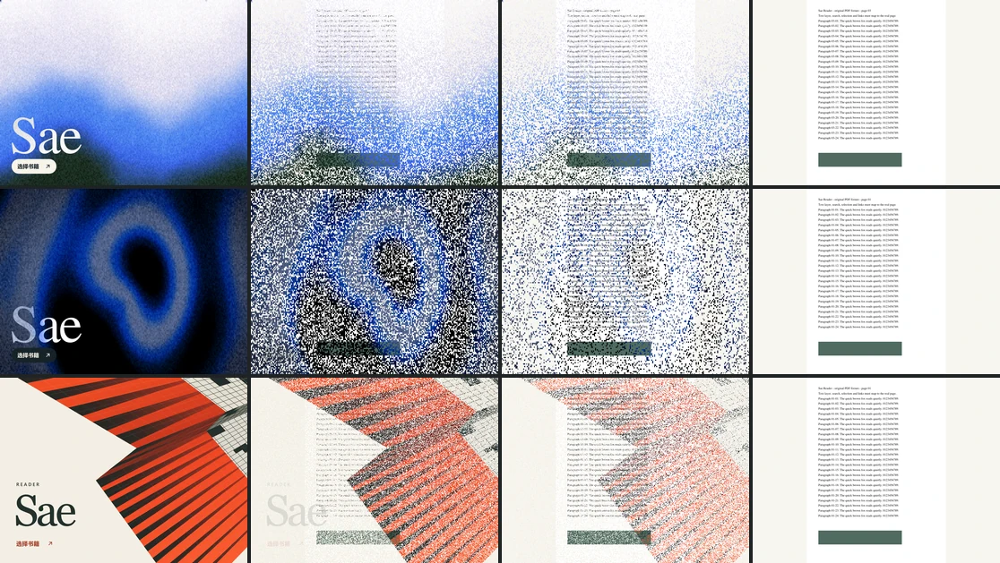

# 0.6.5-preview.4 · 把书拖进窗口

从资源管理器把文件拖到首页，左下角的「选择书籍」会变为「松开打开」。把文件拖回窗口外可以取消。在正文中拖入另一本书会直接换书。多个文件一起拖入时，按 Windows 提供的顺序打开其中第一本支持的书。

从首页拖入或点「选择书籍」后，画面停在选书时的那一帧。等阅读位置和书页都准备好，每一粒会在约 270 毫秒内的不同时间消失。窗口四角、边缘和中央都从一开始就能透出正文。消失的先后与颗粒的明暗无关，每次开书都会换一个随机顺序。

每一行从左到右截自一次真实的开书过程。第一张是选书时的封面，中间两张可以同时看到颗粒和书页，最后一张是正文。第一行演示拖入读过的书后，如何回到上次读的第 3 页。

## 绘制和资源回收

系统窗口直接接收拖入的文件。文档沿用选书按钮的打开流程。过渡叠在已经排好的书页上，直接修改小图中各颗粒的透明度。过渡结束后，首页计时器停止，绘图缓存释放。双击书籍会跳过整个首页，Windows 的「动画效果」关闭或使用 `--motion=static` 时直接显示书页。

在 100% 和 150% 显示缩放下，测试把窗口分成九块，分别比较封面、过渡和正文中能区分的像素。三款封面的边缘和中央都在早期露出书页，结束帧与直接打开同一阅读位置逐像素一致。切换结束后，测试再次检查绘图资源和计时器，观测期间新增的首页帧和过渡帧均为零。

## Windows 实测

在一台 150% 显示缩放的 Windows 11 x64 电脑上，每个版本分别直接打开测试 PDF 和 EPUB 各 20 次，两版交错运行。首屏时间由带测量点的优化构建记录，从程序入口计到原生窗口的首幅可读取画面。稳定期私有内存取正式版三次、每次六秒观察的中位数。

| 双击文件 | 上一版首屏中位数 | 本版首屏中位数 | 上一版稳定内存 | 本版稳定内存 |
| --- | ---: | ---: | ---: | ---: |
| PDF | 151.19 ms | 150.92 ms | 24.40 MiB | 24.38 MiB |
| EPUB | 151.14 ms | 153.32 ms | 21.85 MiB | 21.68 MiB |

从三种首页分别点击真实的 Windows 选书窗口并打开同一份 PDF。下表记录自按下系统「打开」起 1.2 秒内采样到的进程私有内存峰值，以及随后三秒阅读静置期的内存和累计 CPU 时间。采样约每 18 毫秒一次，包含系统选书组件和阅读引擎，各封面每版运行一次。

| 选书入口 | 上一版峰值 | 本版峰值 | 本版静置内存 | 本版三秒 CPU 时间 |
| --- | ---: | ---: | ---: | ---: |
| 蓝白色带 | 30.83 MiB | 32.83 MiB | 30.77 MiB | 0 ms |
| Plasma | 33.85 MiB | 31.59 MiB | 29.65 MiB | 0 ms |
| 朱红版画 | 31.44 MiB | 36.07 MiB | 30.85 MiB | 0 ms |

另用 900 页的自制横竖混排 PDF 检查直接启动。六次热启动的首屏中位数为 158.73 ms，正式版稳定私有内存为 24.47 MiB。

正式版 EXE 为 26,224,640 字节。原生窗口测试另外记录了正文显示后首页与过渡的计时器、图像缓存和新增帧数。详见[测量原始数据](evidence/iteration-0.6.5-p4/windows.json)。
