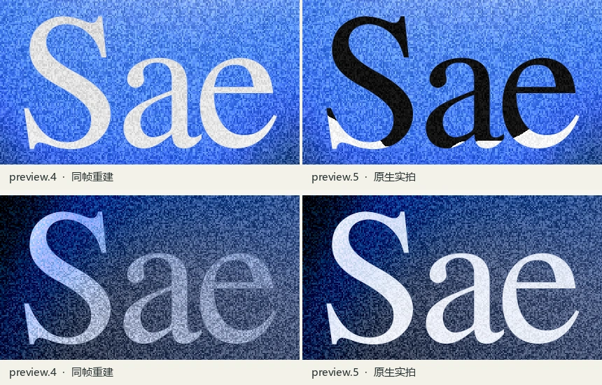
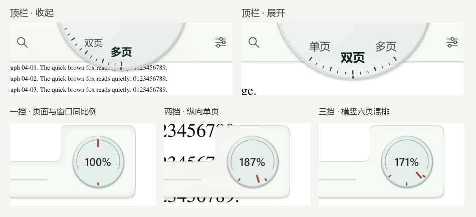

# 0.6.5-preview.5 · 灰带上的字与拨轮的刻度

直接启动 Sae Reader，蓝白色带和 Plasma 两款动态封面轮流出现，也可以用左右方向键切换。灰带经过字标时，整片底色决定笔画用亮墨还是暗墨，笔画里的细颗粒仍然来自屏幕上的同一帧。蓝白色带使用黑白字标，Plasma 的字标会带一点画面里的蓝色。

上排是蓝白色带，下排是 Plasma。右图为新版 Windows 实拍。左图使用同一张底图和 preview.4 的反色算法重建，另用旧版原生截图核对了笔画和抗锯齿边缘。在这两帧的中灰区域，笔画与底图的中位对比度分别由 2.94∶1 提升至 4.99∶1、由 1.67∶1 提升至 4.54∶1。100% 和 150% 显示缩放下各检查两款封面的三个连续帧。

字标只在笔画覆盖的小块区域采样。在 1440 × 960 的实拍窗口中，用于稳定明暗的网格和行缓存合计 750 字节。每次绘制复用已有的字标图像。

## 视图与缩放拨轮

顶栏从一个更大的圆里露出下方 36% 的直径。收起和展开时，圆弧分别比栏底低约 11 和 23 个逻辑像素。标签、刻度和拖动沿同一个圆心转动，只有可选挡位之间有刻度。Windows 在 100%、125%、150%、200% 四档显示缩放下均能辨认双页位置的 13 根向心刻度。

缩放盘根据每一张可见 PDF 页的实际绘制尺寸合并挡位。两种缩放方式在每一页产生的差别都小于半个物理像素时，它们共用一条刻线。悬停可读到挡位名称，点按和拖动吸附沿用相同的刻线。在横竖混排的六页视图中，只要任一页的缩放有可见区别，就能分别选择整页、适宽或铺满。多页的盘心读数取各页相对整页倍率的平均值。

| 原生窗口中的试样 | 可点选的挡位 | 盘心读数 |
| --- | --- | --- |
| 与窗口同为 16∶9 的幻灯片 | 一挡 | 100% |
| 纵向单页 | 两挡 | 100%、187% |
| 横竖混排的六页 | 三挡 | 100%、111%、171% |

这六次点击都核对了实际显示的名称、选中的刻线和每张书页的绘制倍率。空白位置也单独点过。书页和鼠标静止时，两个拨轮的玻璃表面在观察期间都没有重建。

## Windows 实测

在同一台 Windows 11 x64 电脑上，两版交错打开自制 PDF 和 EPUB，每种文件每版运行 20 次。首屏时间从程序入口计到第一次能读到原生窗口画面，用带测量点的优化构建记录。内存使用发布的 EXE，每种文件观测三次，每次六秒，取稳定期进程私有内存中位数。

| 双击文件 | preview.4 首屏中位数 | preview.5 首屏中位数 | preview.4 内存 | preview.5 内存 |
| --- | ---: | ---: | ---: | ---: |
| PDF | 153.37 ms | 159.35 ms | 24.31 MiB | 24.27 MiB |
| EPUB | 159.12 ms | 153.32 ms | 21.90 MiB | 21.62 MiB |

另用 900 页横竖混排的自制 PDF 直接启动六次，首屏中位数为 148.09 ms，稳定期私有内存为 24.64 MiB。正式版 EXE 大小为 26,220,032 字节。

直接双击书籍会跳过封面。通过首页选书或拖入后，颗粒从全屏各处随机消失。两档显示缩放下的七种开书场景均确认，进入正文后封面和过渡缓存已释放，两个计时器均已停止。系统关闭动画时，首页显示其中一款动态封面的首帧。本机另通过 56 项常规 Rust 测试与 13 组 Windows 窗口回归。

另外在三个独立的 Windows 测试桌面上复测了动画。测试桌面无法获得系统前台焦点，这一项由测试程序传入；动画帧数、最小化、恢复、按键切封面与选书后的资源释放都从实际运行的窗口读取。[完整测量数据](evidence/iteration-0.6.5-p5/windows.json)
