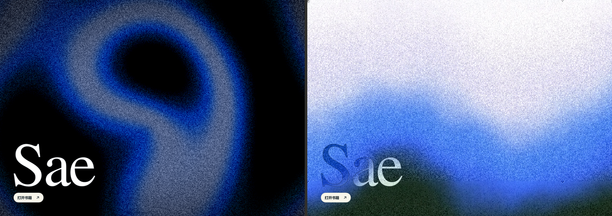
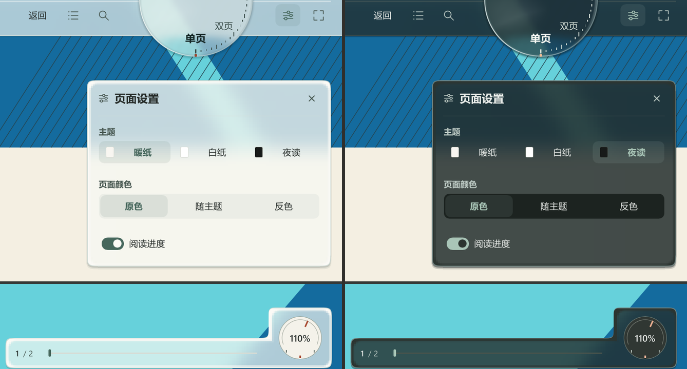

# Sae Reader 0.6.5-preview.1 · 首页与阅读界面

## 蓝白色带与反色字标

Blue Grain 从一端运动到另一端的时间由 26 秒缩短到 16.25 秒，往返为 32.5 秒。固定颗粒的取样密度在两个方向各提高 20%，颗粒间距约为原来的六分之五。前台播放沿用 67 毫秒的帧间隔、原来的 53 个色场关键帧与调色方式。在 640 × 360 的原生输出上抽查 10 个时刻，蓝白色带与分别按新旧速度、颗粒间距计算的参考 RGB 逐像素吻合。Plasma 在这 10 个时刻的背景也与存档逐字节相同。

Sae 的笔画直接取正在显示的那一帧，翻转明暗，同时保留色相和颗粒的运动。深蓝透出浅蓝，暖白处则显出深色笔画。背景明度接近中间值时，细轮廓帮助辨认字形。首页可用左右方向键切换。通过文件启动会直接进入阅读。

在 100% 到 250% 显示缩放和不同窗口尺寸下，28 张原生截图共核对 451,871 个笔画内部像素。按单张统计，至少 99.19% 的像素在每个通道上与目标反色相差不超过 2 个色阶。1770 × 1260 窗口的四个动态样本中，每张抽取的 23,026 个像素全部吻合。动画在选择文件、最小化和打开文档时的帧计数也经过检查。

## 阅读时的毛玻璃

工具栏和进度条透出较多页色，目录、搜索和设置提高底色比重，菜单再收一层，让文字保持清楚。选用深色主题时，各层分别调整明度。下图取自同一张色块与细线 PDF，轮缘、高光与接触阴影在实际书页上可见。

可见控件共用一张至多 144 × 100 的 RGB 取样图，从已渲染的书页生成。在包含顶栏、侧栏、缩放盘展开和切换主题的 12 次截图中，取样图只生成两次，平均 2.13 毫秒。各控件表面生成 24 次，平均 0.19 毫秒。缩放盘的展开过程复用了同一张取样图，静置后重建次数为零。

同一 PDF 上，两次独立测量中同时固定上下栏，私有内存比收起时平均多 0.53 MiB。0.6.4 在相同测试中多 0.45 MiB。新版收起和展开时各有一次 3 秒观察窗记录到 15.6 毫秒 CPU，另一次各为 0 毫秒。

## Windows 性能与回归

Windows 11 Home x64，Core i9-14900HX，32 个逻辑处理器，Slint 软件渲染。同机交错运行两个版本，每项各启动十次。时间从程序启动流程计至可取得原生窗口首幅截图。内存来自实际发行 EXE，每项另开三个进程，每次观察六秒，取稳定期私有字节中位数。下表为热启动测量。

| 场景 | 0.6.4 中位数 / P95 | 0.6.5 中位数 / P95 | 0.6.4 私有内存 | 0.6.5 私有内存 |
| --- | ---: | ---: | ---: | ---: |
| 首页静置 | 53.45 / 62.13 ms | 50.58 / 56.10 ms | 14.27 MiB | 15.31 MiB |
| 样本 PDF | 151.90 / 156.70 ms | 150.37 / 154.26 ms | 21.67 MiB | 21.76 MiB |
| 复杂样本 EPUB | 150.98 / 162.02 ms | 151.54 / 157.36 ms | 18.93 MiB | 18.99 MiB |

前台播放另作测量。Blue Grain 两次各播放约 4.5 秒，私有内存为 18.17–18.20 MiB，CPU 为一个逻辑处理器的 23.6%–27.0%。上一版分别为 16.61–16.94 MiB 和 26.0%–26.3%。Plasma 本版为 18.23–18.40 MiB 和 26.0%–28.1%。两种首页最小化后四次 2.5 秒观察都记录到 0 毫秒 CPU。直接阅读 PDF、EPUB 的六次稳定期观察中也均为 0 毫秒。发行 EXE 为 26,161,152 字节，比上一版增加 267.5 KiB。

46 项常规 Rust 测试通过，另行运行的参考帧输出与 Markdown 原生内存测试通过。13 组 Windows 窗口场景覆盖拨轮、翻页、目录、PDF 多页、复杂 EPUB 排版、显示缩放等。文件格式和旧版验收边界见项目 README。[测量原始数据](evidence/iteration-0.6.5/windows.json) · [项目 README](../README.md)
