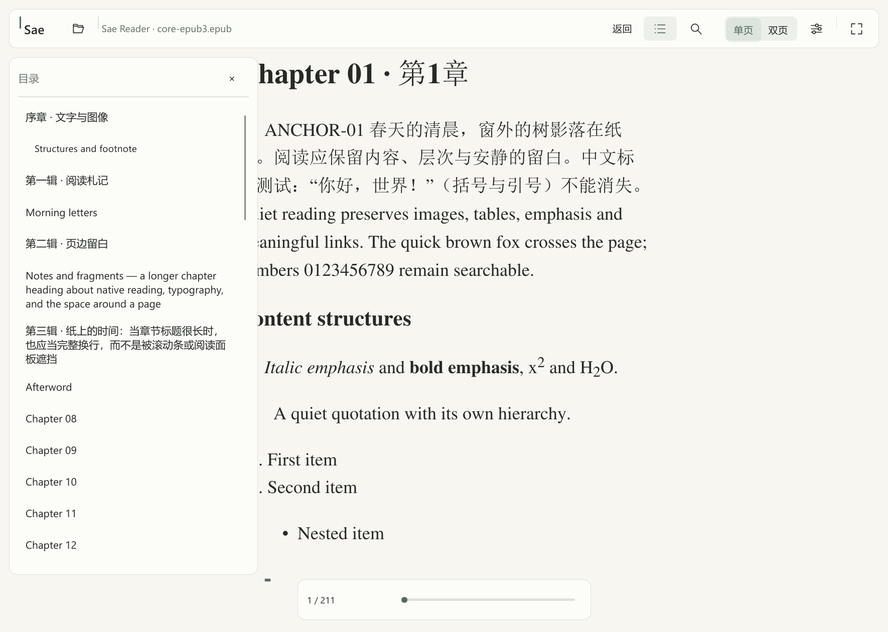
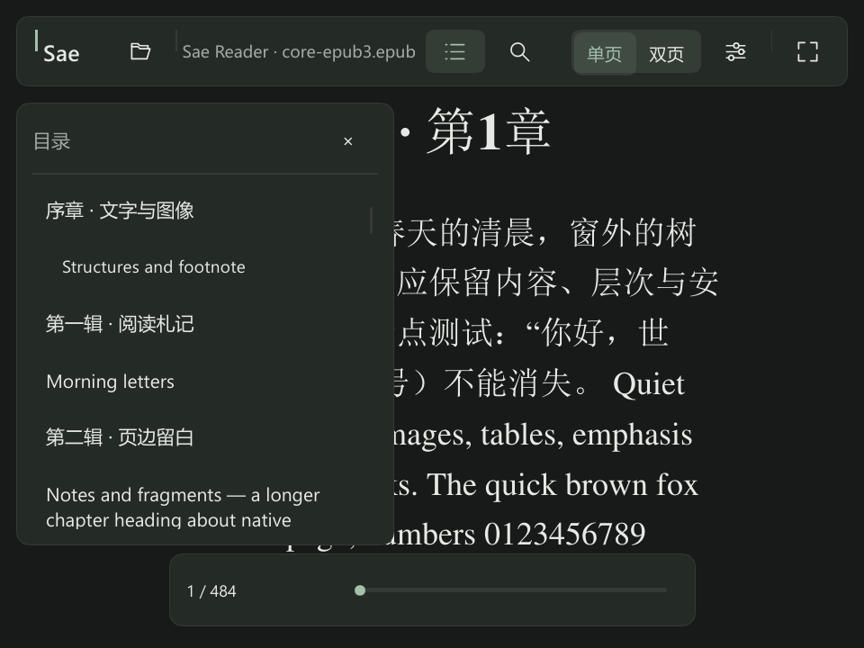
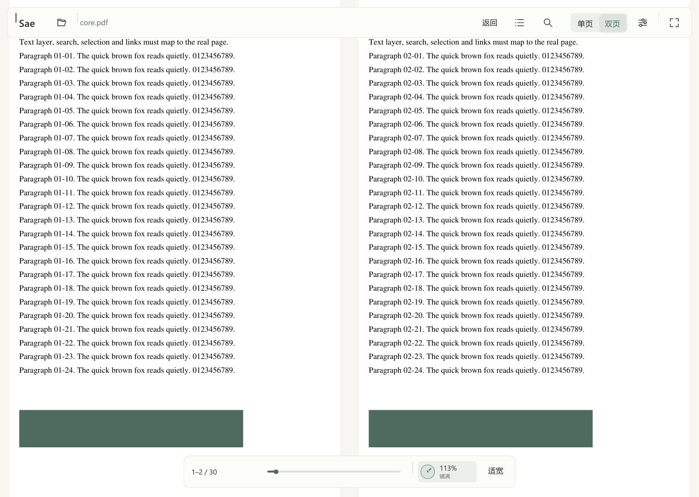
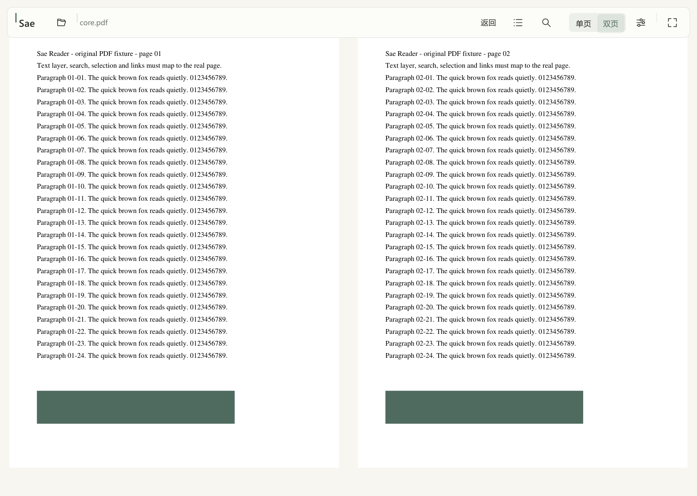
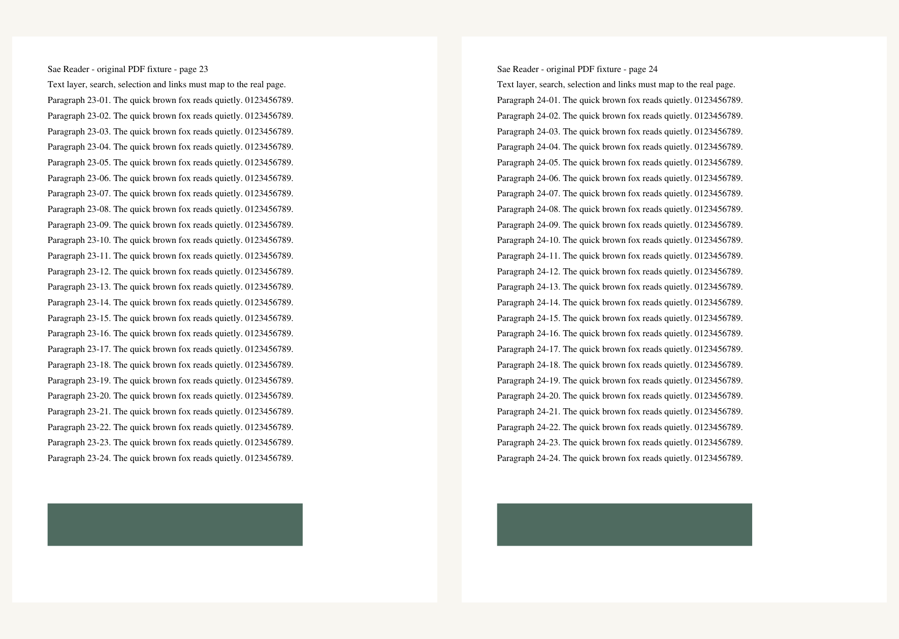

# v0.3.0-preview.1 当前界面检查

目录由居中固定行改为左对齐和真实层级，英文用 Segoe UI，含 CJK 的条目用 Microsoft
YaHei，均为正常字重。55 项原创目录包括多行中文、英文长标题、嵌套项目和附录。
文字按实际可用宽度换行，行高跟随文字；右侧单独保留滚动条空间，面板剪裁边界明确。
已经检查浅色、深色、顶部、中部及靠后位置、640×480 窄窗口；目录与上下浮层边界分开。
窗口截图见 [图像清单](evidence/iteration-0.3/images.json)，未使用用户书籍或桌面图像。

圆盘由一个细圆、中心点和原生路径指针组成。沿圆周拖动使用角度差，数值区拖动使用
线性位移；滚轮触发短暂缓出，拖动直接跟随。整页/铺满标记只在停靠时出现；无持续动画、
皮肤位图、模糊或新增字体。75 项事件检查既比较圆盘区域的实际像素变化，也检查单/双页
停靠后的原生视区几何、输入单调性和继续操作能脱离停靠。

111 项键盘检查覆盖单双页按钮、缩放控件、目录关闭、搜索光标、全屏与窄窗口；
实际 Windows 左右键及 F11/Esc 另有 [普通发行程序输入观察](evidence/iteration-0.3/manual-input.json)。
FB2、AZW3、MOBI 的文字/图像/表格与深色主题有原创样本截图；原有 Ruby/公式、TXT/MD、
PDF 着色与搜索亦有回归。窗口事件汇总为 [12 组回归](evidence/iteration-0.3/window-scenarios.json)。

主机实际 DPI 为 150%；100/125/200% 是真实窗口中的受控 Slint 缩放。仍不宣称多显示器
切换、完整读屏/键盘无障碍、独立美术验收或全部出版方版式已通过。
窄窗请求为 640×480；受控缩放会改变实际逻辑视区：100/125/150/200% 下分别为
928×720、736×576、608×480、448×360（不含左右各 16px 画布留白）。这些尺寸直接来自
窗口报告，不等同于在四档 Windows 系统 DPI 下获得相同客户区的验收。

---

# v0.2.0-preview.1 历史界面检查

以下为本次最终构建，后面的旧轮次记录保留用于对照。构建校验值、25 张截图的来源与内容校验值见 [builds.json](evidence/iteration-0.2/builds.json) 和 [images.json](evidence/iteration-0.2/images.json)。公开图片均为原创 CC0 样本，不包含用户书籍或桌面。

本轮检查确认：品牌、文件名、阅读命令、单双页分组和全屏入口有明确层次；底部页码、细进度条与缩放旋钮收在独立浮层，移除方向平移按钮与操作提示。使用基本矩形、边线和 6 个小 SVG，未加入模糊、位图皮肤或持续动画。浮层和侧栏只覆盖正文，不改变排版宽高。叠在正文上的控件会暂时遮挡其下内容，离开边缘或关闭侧栏后恢复原画面。

实际事件覆盖 [旋钮滚轮](evidence/iteration-0.2/ui-control-zoom-wheel.png)、[旋钮拖动](evidence/iteration-0.2/ui-control-zoom-drag.png)、[进度拖动](evidence/iteration-0.2/ui-control-progress.png)、[右键平移](evidence/iteration-0.2/ui-control-pan.png) 和点击恢复适页。原生 Winit 全屏状态有进入/退出断言；实际 Windows F11 也观察到标题栏与任务栏消失。用户介入后停止键鼠操作，其余控件检查使用程序内 Slint 指针/滚轮事件，不能据此宣称完整物理键鼠路径或触摸板验收。

补充检查了 [设置](evidence/iteration-0.2/ui-chrome-settings.png)、[Markdown](evidence/iteration-0.2/ui-markdown.png)、[TXT](evidence/iteration-0.2/ui-txt.png)、[全文搜索](evidence/iteration-0.2/ui-whole-book-search.png)、[Ruby/公式](evidence/iteration-0.2/ui-ruby-math.png)、[夜读](evidence/iteration-0.2/ui-ruby-math-night.png)、[固定画布](evidence/iteration-0.2/ui-fixed-canvas.png)。原图 SVG、图片和基本数学结构可见；Ruby 注音在基文字上方。原生回归另检文字层与连续基文搜索，未仅凭截图认定可选择或可搜索。

当前实际系统 DPI 为 150%；100/125/200% 是在真实窗口内用 Slint 受控缩放检查。实际多显示器切换、独立审美验收、完整无障碍、出版方样式/任意配色/字重入口仍不宣称完成。

---

# 视觉 QA — 本轮反馈版

本轮按用户要求改为克制的书页界面；G3 全项仍未通过。保留真实窗口渲染和 Windows 屏幕证据，区分引擎 PNG、窗口 renderer snapshot 与桌面捕获。

## 设计选择

实际做了三套轻量候选：默认细线工具栏、居中书名/衬线标题、左侧窄工具轨。候选截图：evidence/feedback/ui-paper-double.png、ui-design-1.png、ui-design-2.png。选择默认方案：工具栏层级更稳定，省去重复工具轨，书名不与正文标题争夺注意。没有背景照片、模糊、阴影、动画或常驻刷新。

Token：暖纸 #F8F6F1、浅色界面 #F3F4EF、正文 #262A27、次要文字 #707971、分隔线 #DDE1D8、强调 #506C60；深色纸张 #171A19、文字 #E7E9E5、强调 #A4C1AA。UI 使用系统 Microsoft YaHei UI / Segoe UI，阅读字体由 MuPDF 和用户设置决定，强调/标题/代码保留语义。未捆绑 Windows 字体。

间距以 8/16/24px 为主，顶部 56px、底部 42px，侧栏按需展开。固定画布不受位图固有尺寸撑开，双页间隔 32px，中线仅 1px。状态行高度固定，避免「正在打开」消失后再触发一次重排。字体选择首次打开面板才枚举名称。

## 已检查场景

| 场景 | 证据 | 结果 / 限制 |
|---|---|---|
| 暖纸单页，中文/英文/标题 | evidence/feedback/ui-paper-single.png | 第一张文档图像直接使用最终窗口尺寸；真实文字重排 |
| 双页与插图 | ui-paper-double.png | 相邻两页、统一基线、间距与中线，完整显示图像 |
| 图片、表格、嵌入字体、脚注 | ui-image-table.png、evidence/ui-native-wheel-double.png | 原创样本能见图像/表格/EMBED；复杂分页表格仍需对照 |
| 目录 | ui-contents.png | 标题/行间距和滚动列表可见；超长标题省略 |
| 当前页搜索 | ui-search-native.png | 最终普通发行窗口搜索 Quiet，两处高亮与实际文字位置一致；全文搜索仍未实现 |
| 排版侧栏 | ui-typography.png | 字号、行距、段距、数值输入/滑块显示正常 |
| 夜读，英语斜体/段落/引用 | ui-night.png | 界面与正文一致；图片保留原色，图片自带白边不被反色 |
| 窄窗口 | ui-narrow.png | 双页偏好保留，画布不足 800px 时暂用单页，底部明确提示 |
| PDF | ui-pdf.png | 固定版式整页显示，禁止字体/行距假重排 |
| Windows 实际滚轮和焦点 | evidence/ui-native-wheel-double.png 与 .txt | 单页一次一页、双页一次一跨页；按钮有键盘焦点 |

表中除最后一行外主要使用真实可见 Winit 窗口的 renderer snapshot，非仅导出的 MuPDF 页面 PNG。桌面窗口捕获另由 Computer Use 记录，包含系统标题栏与实际输入结果。截图均为项目原创样本，未把用户书籍图像写入文档或发行包。

实际主机 150% DPI；ui-controlled-scale-1.png、-1.25.png、-1.5.png、-2.png 使用 SLINT_SCALE_FACTOR 在真实窗口进行受控缩放检查，覆盖重排、控件、画面和尺寸变化。它们**不等于**把 Windows 显示设置/显示器分别改为四档，尤其窗口逻辑尺寸和系统 DPI 不一致时不能据此认定跨显示器行为通过。

## 截图检查中修正

去掉 effective-spread 对画布布局的循环绑定；分隔线固定在面板边缘/页脚顶部；加载状态不改变画布高度；等待首次 DPI/客户区稳定，避免临时小页面后再跳版；metadata 更新共享图像，不反复复制并清除选择。

## 未验收

实际 100/125/200% 系统 DPI 与跨屏切换、全文搜索视觉、独立人工审美复核、屏幕阅读器全过程、Markdown 代码/表格、完整单书与全局样式范围、字重/自定义色/出版方样式入口。PDF 放大后的平移待实现。不能把这组截图视为 G3 所有项已通过。

最终手工测试中，部分设置/编辑控件焦点下 Escape 未关闭面板；可见关闭/收起入口可用。该快捷键传播问题列为待修，未把完整键盘路径判为通过。

## 用户图标

本日用户提供的透明 PNG 原稿为 1284×1225。按比例缩小并透明补方，生成
16/20/24/32/48/64/128/256px ICO 和 128px 窗口 PNG；没有改画或重新生成图案。
原稿、128px 派生文件已直接检查，留白和透明通道保留；缩小资源与来源见
`assets/README.md`、`assets/icon-manifest.json`。

普通 Release 已编译并包含 Windows 文件版本信息；PE 图标目录由
`scripts/verify-package.py` 检查。此次系统标题栏/任务栏视觉检查未完成：
Computer Use 刷新绑定后仍两次报告 `failed to activate captured window`。
资源检查与既有正文界面截图不能代替该系统外观检查。
