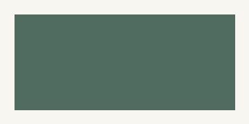

# 编码验证 · Markdown 阅读

正文包含 **加粗**、*斜体* 和 [外部链接](https://example.org)。

## 列表、代码与表格

1. 第一项
2. 第二项
   - 嵌套列表

> 一段引用。文字与图片都应保留。

```rust
fn main() {
    println!("Reading text, images and tables stays native.");
}
```

| Feature | Expected |
| --- | --- |
| Table | TABLE-CELL |
| Image | Original illustration |



---

[回到标题](#编码验证-·-markdown-阅读)

<script>Raw HTML is visible text, never executable.</script>
